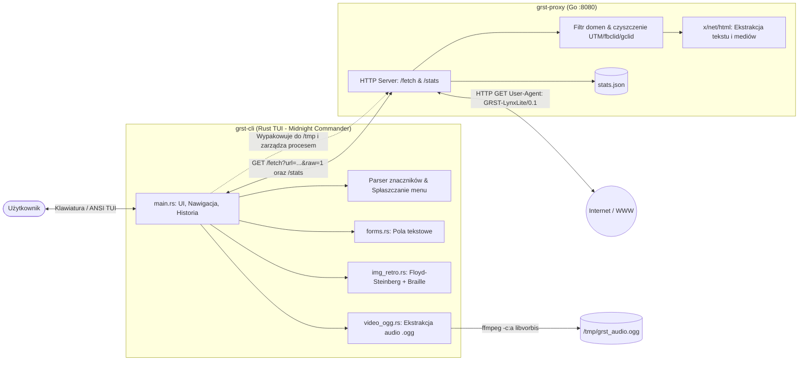

# 🖥️ GRST-MC (`grst-cli`)

Terminalowa przeglądarka internetowa (TUI) napisana w języku **Rust**, inspirowana klasycznym interfejsem **Midnight Commander**. Aplikacja współpracuje z wbudowanym lokalnym serwerem proxy (`grst-proxy`), kompresując treść stron i renderując multimedia w stylu retro (czarno-biała grafika Braille'a z ditheringiem Floyda-Steinberga oraz ekstrakcja audio do OGG).

https://github.com/user-attachments/assets/e7412cf4-0d02-4058-b0d3-6db76aec7714

### Analiza backendu (`grst-proxy` w Go)

* **Rola w ekosystemie:** Lokalny serwer HTTP działający na porcie `:8080` (`module grst`, Go 1.27.4), który pełni funkcję **bramki odchudzającej i filtrującej ruch sieciowy** (w stylu przeglądarki tekstowej *Lynx*) dla klienta `grst-cli`.


* **Przetwarzanie HTML (`extractLynxView`):**
* Wykorzystuje `golang.org/x/net/html` do parsowania drzewa DOM.


* Całkowicie wycina zbędne dla terminala elementy: `<script>`, `<style>`, `<noscript>`, `<svg>`.


* Zamienia tagi `<a>`, ``, `<video>` na ustrukturyzowane znaczniki tekstowe zrozumiałe dla parsera w Rust (`[1: Etykieta -> URL]`, `[OBRAZ: alt -> src]`, `[WIDEO -> src]`).


* Rozwiązuje relatywne ścieżki względem bazowego URL i zagęszcza puste linie oraz nadmiarowe białe znaki (`collapseBlankLines`).


* **Prywatność i AdBlock (wbudowane filtry):**
* **Blokada domen (`blockedDomains`):** Odrzuca żądania oraz zasoby z domen reklamowych i analitycznych (`doubleclick.net`, `googlesyndication.com`, `google-analytics.com`, `googletagmanager.com`, `gemius.pl`, `ads.pubmatic.com`) — zarówno na poziomie całej strony (`HTTP 403`), jak i pojedynczych linków/obrazów w DOM.


* **Czyszczenie URL (`cleanTrackingURL`):** Automatycznie usuwa z odnośników parametry śledzące (`utm_*`, `fbclid`, `gclid`, `src`, `tpcc`).


* **Telemetria i oszczędność transferu (`stats.json`):**
* Atomowo zapisuje statystyki (zapis do pliku `.tmp` + `os.Rename` pod kontrolą `sync.Mutex`) do `stats.json` (lub ścieżki z `GRST_STATS_FILE`).


* Przykładowo w załączonym `stats.json` (po 256 pobranych stronach): z **~42,15 MB** surowego HTML proxy zredukowało ruch do **~3,08 MB** czystego tekstu — dając **~92,7% oszczędności transferu** (ponad **39 MB** zaoszczędzonych danych).


* **Uwaga techniczna (integracja Rust ↔ Go):**
* W `main.rs` przy otwieraniu obrazów i wideo klient wywołuje `/fetch?url=<media_url>` bez `raw=1`, natomiast `fetchHandler` w `main.go` zawsze parsuje odpowiedź jako HTML przez `extractLynxView` i zwraca JSON (`FetchResult`) lub tekst, zamiast przekazywać surowe bajty binarne obrazów/wideo. Dodanie trybu passthrough (np. `/fetch?url=...&binary=1` lub wykrywania nagłówka `Content-Type` innego niż `text/html`) pozwoli na bezpośrednie pobieranie plików graficznych i wideo przez proxy.


---

### Zaktualizowany plik `README.md` na GitHub

```markdown
# 🖥️ GRST — Hybrydowa Przeglądarka Terminalowa (Go Proxy + Rust TUI)

**GRST** to lekki, dwuczęściowy system przeglądania sieci w terminalu, zaprojektowany z myślą o maksymalnej oszczędności transferu, prywatności i estetyce retro:
1. **`grst-proxy` (Go):** Lokalny serwer proxy filtrujący reklamy, trackery i zbędny kod (JS/CSS/SVG), konwertujący strony HTML do lekkiego formatu tekstowego (redukcja rozmiaru stron o **~90%**).
2. **`grst-cli` (Rust):** Klient terminalowy (TUI) stylizowany na **Midnight Commander**, który osadza binarkę proxy w sobie, renderuje treść oraz wyświetla obrazy w czarno-białej grafice **Braille'a (1980 B&W)** i obsługuje audio **OGG**.

---

## 🏗️ Architektura i schemat działania



### Przepływ danych (ASCII)

```text
+-----------------------+    HTTP 127.0.0.1:8080     +------------------------+      HTTP/HTTPS      +-------------+
|       grst-cli        | -------------------------> |       grst-proxy       | -------------------> |   Internet  |
|  (Rust TUI - styl MC) |  GET /fetch?url=...&raw=1  |    (Go + x/net/html)   |                      |  (Strony,   |
|  * Osadza binarkę Go  | <------------------------- | * Blokuje reklamy      | <------------------- |   HTML)     |
|  * Renderuje Braille  |   Tekst + [1: Link -> URL] | * Usuwa JS/CSS/UTM     |   Surowy HTML (~MB)  |             |
+-----------------------+   + [OBRAZ/WIDEO -> URL]   | * Zapisuje stats.json  |                      +-------------+
            |                                        +------------------------+
            +---> [OBRAZ < 1MB] ---> Lanczos3 -> Wyostrzanie -> Floyd-Steinberg -> Znaki Braille'a (U+2800)
            +---> [WIDEO < 5MB] ---> ffmpeg (libvorbis) -------------------------> /tmp/grst_audio.ogg

```

---

## ✨ Główne funkcje

### Backend (`grst-proxy` – Go)

* **Redukcja transferu ~92%:** Wycinanie tagów `<script>`, `<style>`, `<noscript>`, `<svg>` oraz kompresja białych znaków (w testach na 256 stronach: z `44.19 MB` surowego HTML do `3.23 MB` czystego tekstu).
* **Wbudowany AdBlock & Anti-Tracking:**
* Blokowanie domen reklamowych i analitycznych (`doubleclick.net`, `googlesyndication.com`, `google-analytics.com`, `googletagmanager.com`, `gemius.pl`, `ads.pubmatic.com`).
* Automatyczne usuwanie parametrów śledzących z adresów URL (`utm_*`, `fbclid`, `gclid`, `src`, `tpcc`).


* **Trwałe statystyki (`stats.json`):** Atomowy zapis metryk (pobrane strony, zaoszczędzone bajty, pominięte obrazy/wideo/linki, zablokowane domeny) z obsługą zmiennej środowiskowej `GRST_STATS_FILE`.
* **API HTTP:**
* `GET /fetch?url=<URL>` — zwraca obiekt JSON (`FetchResult`) ze statystykami i oczyszczonym widokiem strony.
* `GET /fetch?url=<URL>&raw=1` — zwraca czysty tekst (`text/plain`) gotowy do bezpośredniego renderowania przez `grst-cli`.
* `GET /stats` — zwraca globalne statystyki z `stats.json`.


### Klient TUI (`grst-cli` – Rust)

* **Interfejs Midnight Commander:** Dwupanelowy układ (treść strony + lista linków), pasek statusu, historia nawigacji i dolny pasek skrótów — bez ciężkich zależności TUI (czyste sekwencje ANSI + `stty raw`).
* **Autonomiczne zarządzanie procesem (RAII):** Klient zawiera wkompilowaną binarkę `grst-proxy` (`include_bytes!`), automatycznie uruchamia ją w tle przy starcie i zatrzymuje przy zamknięciu programu (`ProxyGuard` + `TerminalGuard`).
* **Spłaszczanie pionowych menu:** Wykrywa wieloelementowe, pionowe listy nawigacyjne i grupuje je w kompaktowe, poziome paski rozdzielone znakiem `│`.
* **Grafika 1980 B&W Braille (`img_retro.rs`):** Przetwarza obrazy do **1 MB** (HTTP oraz `data:image/...;base64`) za pomocą skalowania Lanczos3, wyostrzania krawędzi i ditheringu **Floyda-Steinberga** na siatkę znaków Unicode Braille (`2×4` piksele na znak) z możliwością zmiany skali w podglądzie (`-`, `+`, `z`).
* **Ekstrakcja audio OGG (`video_ogg.rs`):** Obsługuje pliki wideo do **5 MB**, wyodrębniając ścieżkę dźwiękową do `/tmp/grst_audio.ogg` przy użyciu `ffmpeg` (`libvorbis`).

---

## 📁 Struktura repozytorium

```text
GRST/
├── proxy/                  # Backend w języku Go (module grst)
│   ├── main.go             # Serwer HTTP (:8080), parser HTML, filtr domen/UTM, statystyki
│   ├── go.mod              # Zależności Go (golang.org/x/net)
│   ├── go.sum              # Sumy kontrolne modułów Go
│   └── stats.json          # Zapisane statystyki oszczędności transferu
│
└── grst-cli/               # Klient terminalowy w języku Rust (Edition 2024)
    ├── Cargo.toml          # Konfiguracja pakietu Rust (image, base64)
    ├── Cargo.lock          # Zablokowane wersje zależności
    └── src/
        ├── main.rs         # Główna pętla TUI, klient proxy, parser dokumentów, obsługa klawiatury
        ├── img_retro.rs    # Dithering Floyda-Steinberga i rendering znakami Braille'a
        ├── video_ogg.rs    # Obsługa wideo < 5MB i konwersja audio do .ogg
        ├── forms.rs        # Obsługa stanu pól formularzy
        └── retro_test.rs   # Alternatywny / testowy renderer ASCII B&W

```

---

## 🚀 Kompilacja i uruchomienie

Ze względu na to, że `grst-cli` osadza skompilowaną binarkę `grst-proxy` w czasie kompilacji (`include_bytes!("../../grst-proxy")`), projekt należy budować w dwóch krokach (najpierw Go, potem Rust).

### Wymagania

* **System:** Linux / Unix (wymagane `stty` oraz terminal wspierający kody ANSI i znaki Unicode Braille).
* **Go:** wersja `1.22+` (moduł deklaruje `go 1.27.4`).
* **Rust:** `cargo` / `rustc` (Edition 2024).
* **Opcjonalnie:** `ffmpeg` z kodekiem `libvorbis` (do konwersji audio z wideo na `.ogg`).

### Budowanie krok po kroku

```bash
# 1. Zbuduj serwer proxy w Go i umieść binarkę w oczekiwanej lokalizacji
cd proxy
go build -o ../grst-proxy .
cd ..

# 2. Zbuduj klienta TUI w Rust (osadzi ../grst-proxy wewnątrz binarki)
cd grst-cli
cargo build --release

# 3. Uruchom przeglądarkę (domyślnie otwiera [https://onet.pl](https://onet.pl))
./target/release/grst-cli

# Lub podaj własny adres startowy:
./target/release/grst-cli [https://example.com](https://example.com)

```

> **Wskazówka:** Możesz również uruchomić samo proxy niezależnie jako lokalne API:
> ```bash
> GRST_STATS_FILE=./stats.json ./grst-proxy
> curl "http://localhost:8080/fetch?url=[https://example.com](https://example.com)"
> 
> ```
> 
> 

---

## ⌨️ Skróty klawiszowe (`grst-cli`)

### Nawigacja główna

| Klawisz | Akcja |
| --- | --- |
| `Tab` | Przełączenie fokusu między panelem **Treści** a panelem **Linków** |
| `↑` / `k` oraz `↓` / `j` | Przewijanie dokumentu lub wybór linku na liście |
| `PgUp` / `PgDn` / `Spacja` | Szybkie przewijanie treści (co 15 wierszy) |
| `Home` / `End` | Skok na początek lub koniec strony / listy linków |
| `n` / `p` | Następny / poprzedni link (przełącza fokus na listę linków) |
| `]` / `[` lub `h` | Skok o `+10` / `-10` linków na liście |
| `0`–`9` + `Enter` | Bezpośrednie otwarcie linku o wpisanym numerze |
| `Enter` | Otwarcie zaznaczonego linku, podglądu obrazu lub wideo |
| `g` | Wpisanie nowego adresu URL |
| `b` | Powrót do poprzedniej strony z historii |
| `r` | Odświeżenie bieżącej strony |
| `/` | Wyszukiwanie frazy na bieżącej stronie |
| `i` | Tryb edycji pól formularza (`Tab` zmienia pole, `Enter` zatwierdza) |
| `s` | Wyświetlenie statystyk oszczędności transferu (`/stats`) |
| `q` | Wyjście z aplikacji i bezpieczne zatrzymanie `grst-proxy` |

### Podgląd obrazów (Modal 1980 B&W Braille)

| Klawisz | Akcja |
| --- | --- |
| `-` | Zmniejszenie rozmiaru obrazu |
| `+` / `=` | Powiększenie rozmiaru obrazu |
| `z` | Przełączenie trybu kompaktowego / standardowego |
| `Esc` / `Enter` / `q` | Zamknięcie podglądu obrazu |

```

```
